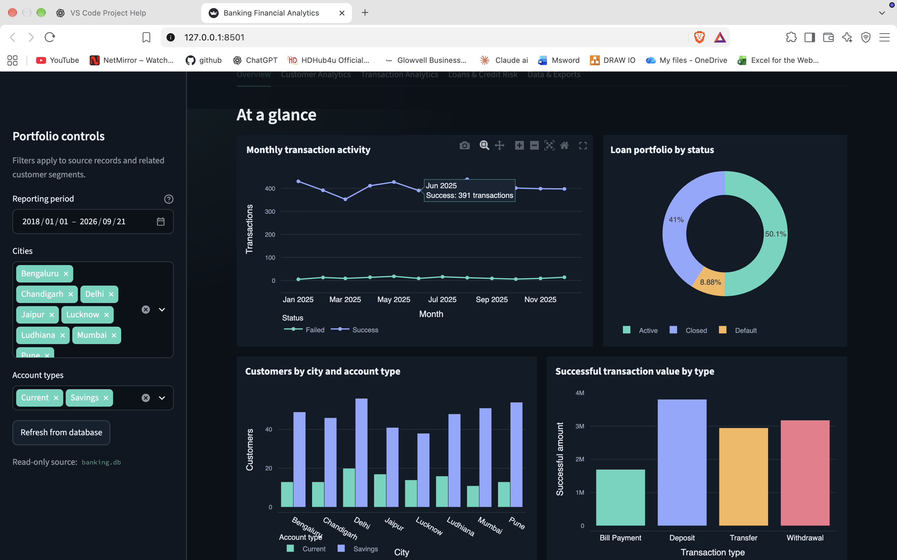
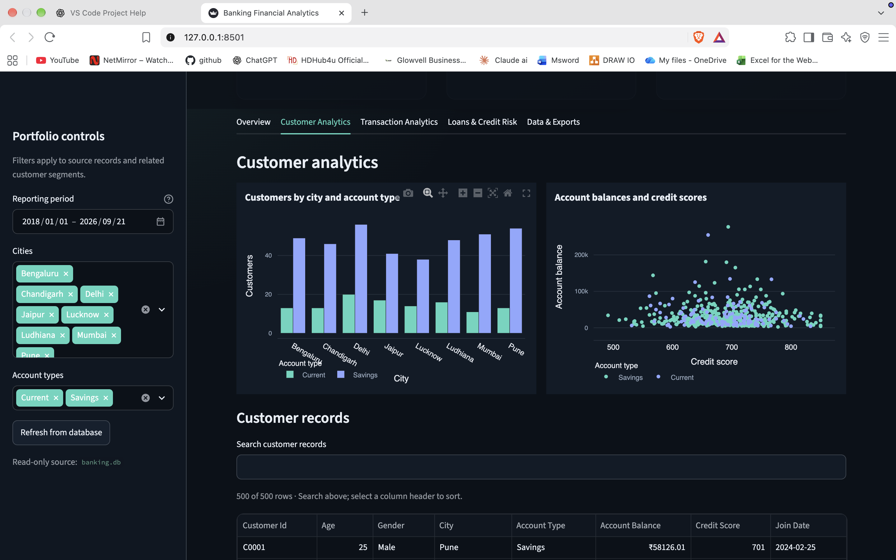
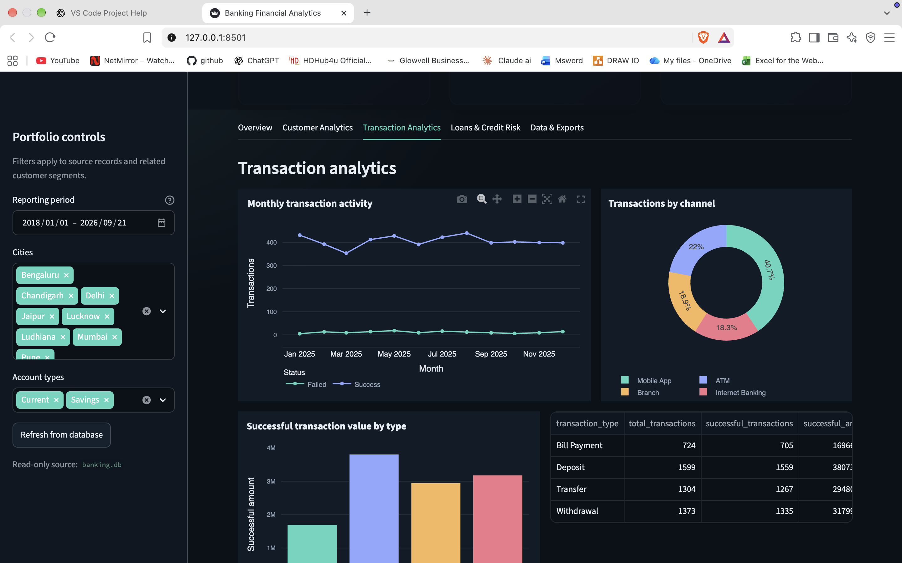
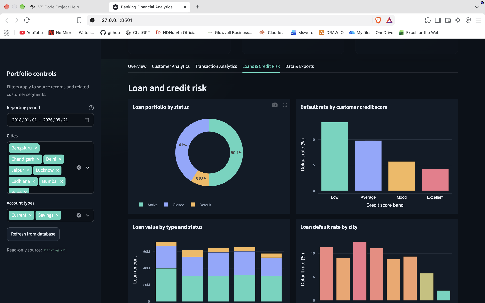
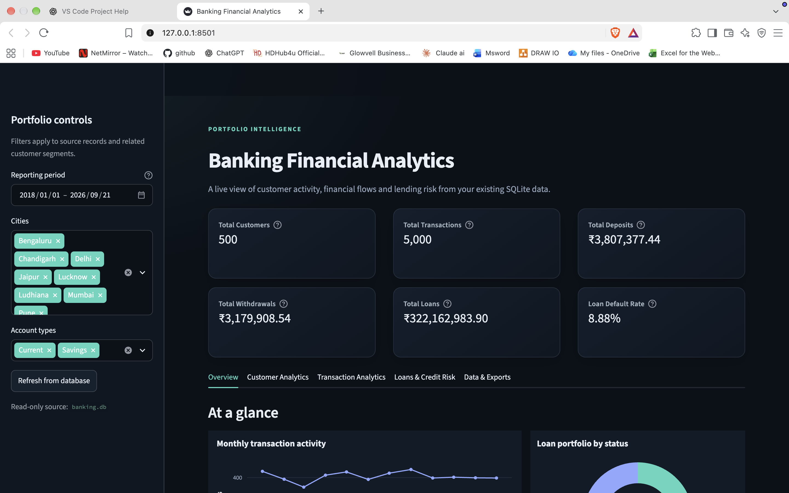

# Banking & Financial Analytics

An end-to-end banking analytics project that explores customer profiles, transaction activity, loan performance, and credit risk using **Python, SQL, SQLite, Excel, and Streamlit**.

The project combines data preparation, exploratory analysis, SQL-based business queries, an interactive dashboard, and an Excel reporting workbook.

> **Dataset notice:** All datasets used in this project are synthetic and created for educational and portfolio demonstration purposes. They do not represent real customers or financial accounts.

---

## Project at a Glance

| Area | Details |
|---|---|
| Domain | Banking & Financial Services |
| Analysis | Customer analytics, transaction analysis, loan analysis, credit risk |
| Programming | Python, Pandas, NumPy |
| Database | SQLite, SQL |
| Reporting | Excel |
| Dashboard | Streamlit, Plotly |
| Data | Synthetic CSV datasets |

## Dashboard Preview

The repository includes dashboard screenshots in the `screenshots/` folder.

### Overview


### Customer Analytics


### Transaction Analytics


### Loan Risk Analysis


### Dashboard


---

## Business Problem

Banking teams need to understand customer activity, monitor transaction patterns, evaluate loan portfolios, and identify potential credit risk. This project demonstrates how structured datasets can be prepared and analyzed to produce useful business summaries and visual reports.

## Project Objectives

- Analyze customer demographics and account balances.
- Explore transaction volumes, types, and trends.
- Evaluate loan distribution and loan status.
- Examine credit scores in relation to loan defaults.
- Compare customer and loan activity across cities.
- Present findings through an interactive dashboard and Excel report.

## Technology Stack

| Technology | Purpose |
|---|---|
| Python | Data processing and analysis |
| Pandas | Data cleaning and manipulation |
| NumPy | Numerical operations |
| SQLite | Relational data storage |
| SQL | Business queries and analytical summaries |
| Matplotlib / Seaborn | Data visualization |
| Streamlit | Interactive dashboard |
| Plotly | Interactive charts |
| Excel | Dashboard-style reporting |
| OpenPyXL | Excel workbook formatting and automation |

## Dataset Description

The project uses three synthetic datasets:

| Dataset | Records | Description |
|---|---:|---|
| `customers.csv` | 500 | Customer and account information |
| `transactions.csv` | 5,000 | Banking transaction records |
| `loans.csv` | 800 | Loan information and status |

The datasets are linked through the common `customer_id` field.

**Important:** These are synthetic records, not actual banking or customer data.

## Analysis Performed

### 1. Customer Analytics
- Customer and account overview
- Account balance analysis
- City-wise customer comparisons
- Customer segmentation and summaries

### 2. Transaction Analytics
- Transaction type analysis
- Deposit and withdrawal activity
- Transaction volume comparisons
- City-wise transaction analysis
- Transaction summaries and trends

### 3. Loan & Credit Risk Analysis
- Loan status distribution
- Loan portfolio analysis
- Credit score categorization
- Credit score versus loan default analysis
- City-wise loan risk analysis

### 4. SQL Analysis
The SQL scripts demonstrate:
- Filtering, sorting, and aggregation
- Joins across banking datasets
- Grouped business summaries
- Customer ranking
- Window functions
- Running totals and transaction comparisons
- Loan and credit-risk queries

## Key Findings

The current analysis documented in this project reports the following observations:

- 500 customers, 5,000 transactions, and 800 loans were analyzed.
- Deposit transactions have the highest transaction count.
- Delhi has the highest transaction volume among the cities analyzed.
- Active loans represent the largest loan-status category.
- The overall loan default rate is approximately **8.88%**.
- Customers in the low credit-score category have a higher loan-default percentage than customers in higher credit-score categories.

These findings are based on the synthetic datasets included in this repository and should not be interpreted as real-world banking statistics.

## Excel Report

The formatted Excel workbook is available here:

[**Open / download the final Excel report**](reports/Banking_Financial_Analytics_final.xlsx)

The workbook contains analysis sheets for:
- Dashboard
- Customers
- Transactions
- Loans
- Transaction Summary
- Loan Summary
- City Analysis
- Credit Risk

## Project Structure

```text
Banking-Financial-Analytics/
│
├── dashboard/
│   ├── __init__.py
│   ├── analytics.py
│   ├── app.py
│   ├── charts.py
│   ├── data.py
│   ├── exports.py
│   └── styles.py
│
├── dataset/
│   ├── customers.csv
│   ├── loans.csv
│   ├── transactions.csv
│   └── README.md
│
├── python/
│   ├── __init__.py
│   ├── data_cleaning.py
│   ├── eda.py
│   ├── export_data.py
│   ├── format_charts.py
│   ├── format_dashboard.py
│   ├── generate_synthetic_data.py
│   └── main.py
│
├── reports/
│   ├── Banking_Financial_Analytics_final.xlsx
│   └── README.md
│
├── screenshots/
│   ├── customer-analytics.png
│   ├── dashboard.png
│   ├── loan-risk.png
│   ├── overview.png
│   └── transaction-analytics.png
│
├── sql/
│   ├── banking_analysis.sql
│   └── banking_analysis_queries.sql
│
├── tests/
│   └── test_dashboard_analytics.py
│
├── banking.db
├── requirements.txt
└── README.md
```

## Getting Started

### Prerequisites

- Python 3.10 or later
- pip
- Git

### 1. Clone the repository

```bash
git clone https://github.com/mayankspppp/Banking-Financial-Analytics.git
cd Banking-Financial-Analytics
```

### 2. Create and activate a virtual environment

**macOS / Linux**
```bash
python3 -m venv .venv
source .venv/bin/activate
```

**Windows**
```powershell
python -m venv .venv
.venv\Scripts\activate
```

### 3. Install dependencies

```bash
pip install -r requirements.txt
```

### 4. Run the Streamlit dashboard

From the project root:

```bash
streamlit run dashboard/app.py
```

Streamlit will display a local URL in the terminal. Open that URL in your browser to use the dashboard.

### 5. Run the Python analysis

```bash
python python/main.py
```

Additional scripts are available in the `python/` folder for data cleaning, EDA, exports, and report formatting.

### 6. Explore the SQL analysis

Open the SQL scripts in the `sql/` folder and run the queries against the included SQLite database using a SQLite-compatible tool.

## Testing

The repository includes dashboard analytics tests in:

```text
tests/test_dashboard_analytics.py
```

Run the test suite from the project root:

```bash
pytest
```

## What This Project Demonstrates

- Data cleaning and exploratory data analysis
- Relational data analysis using SQL and SQLite
- Customer, transaction, and loan analytics
- Credit-risk exploration
- Interactive dashboard development
- Excel reporting and visualization
- Organizing an analytics project for reproducibility

## Future Improvements

- Add automated data-quality checks and validation.
- Add more interactive dashboard filters.
- Expand time-based trend analysis.
- Add a repeatable end-to-end pipeline for generating datasets and reports.
- Improve test coverage for data processing and dashboard components.

## Disclaimer

This project is for educational and portfolio demonstration purposes only. All datasets are synthetic. The analysis is not financial advice, a credit decision system, or a representation of any real bank or customer.

---

**Built as a Data Analytics portfolio project using Python, SQL, SQLite, Excel, and Streamlit.**
